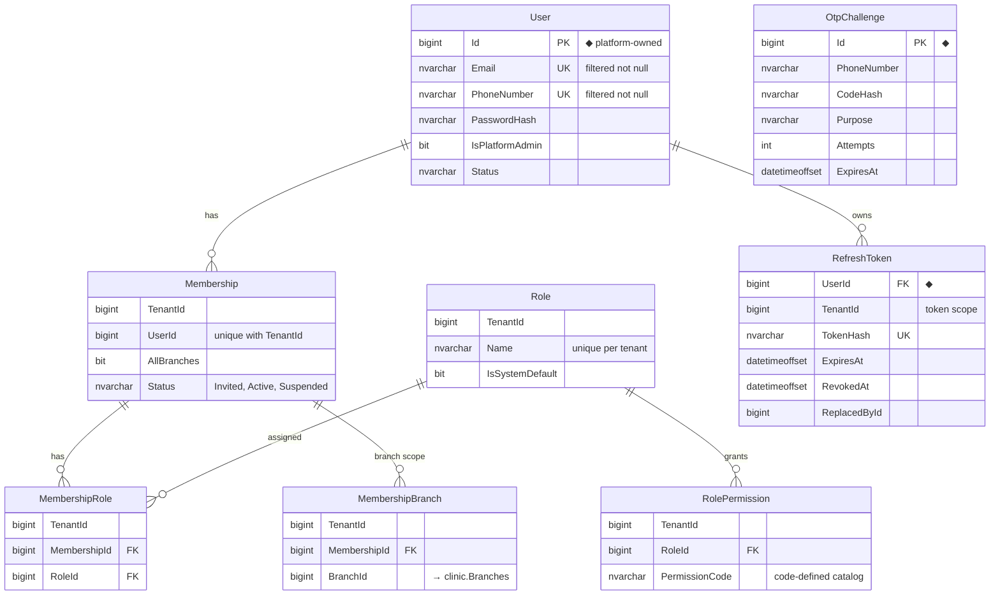
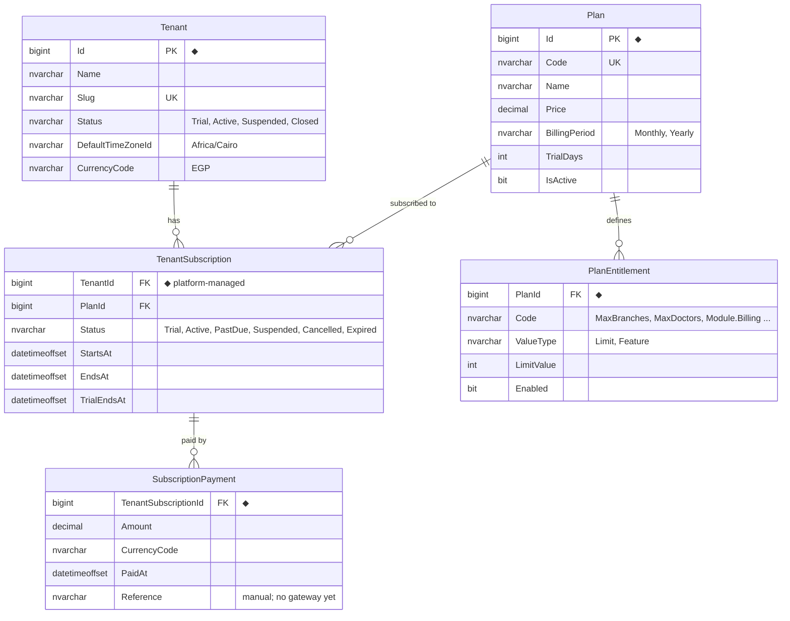
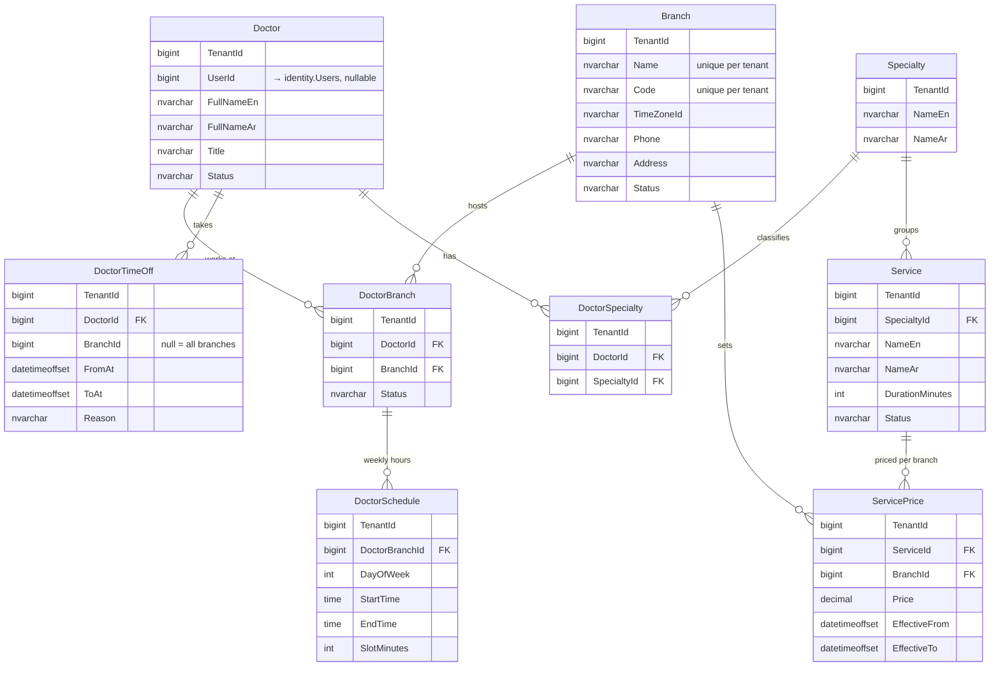
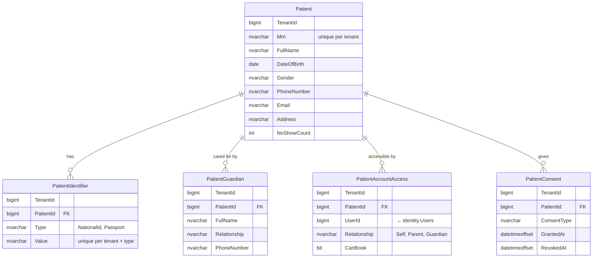
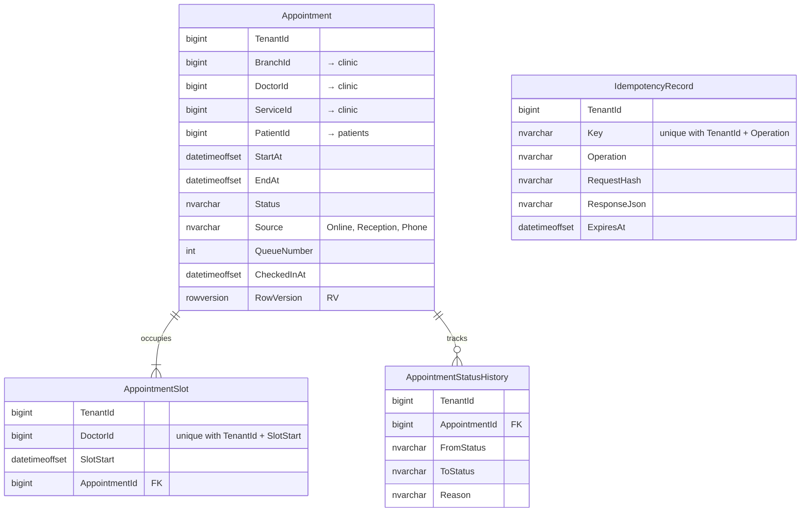
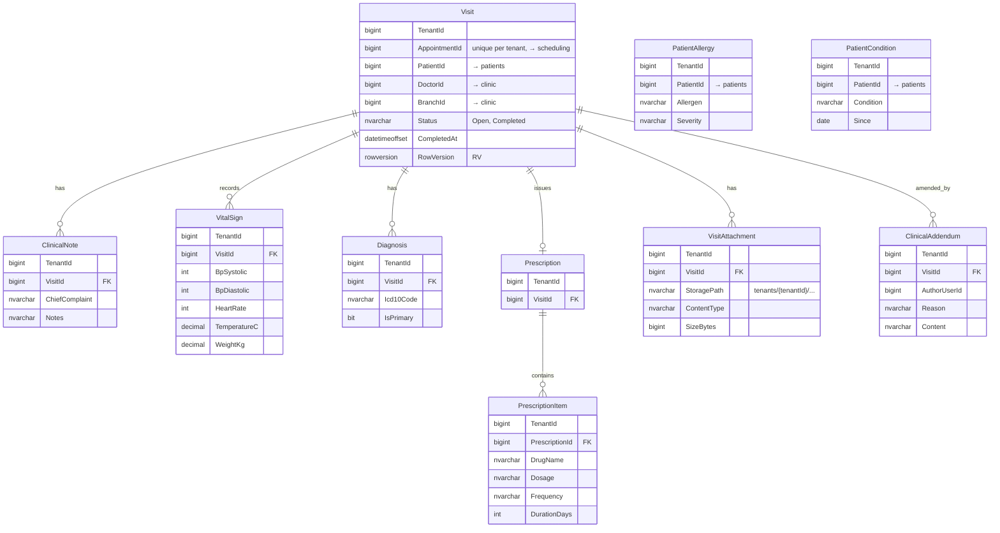
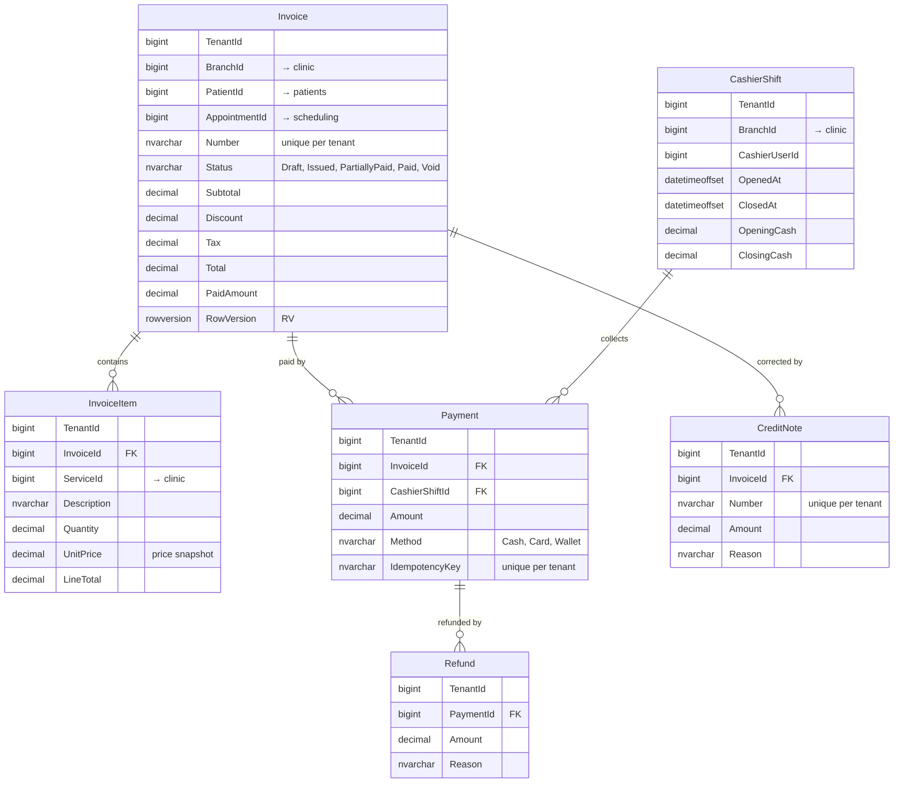
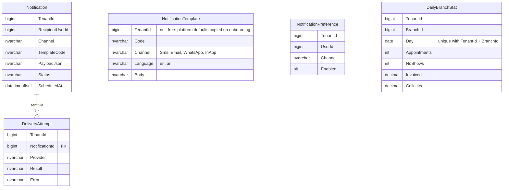

# Database design

Decision: ADR-003. Tenancy rules: [tenancy-design.md](tenancy-design.md).

## Conventions

- One SQL Server database, one schema per module. Tables and columns use EF Core default PascalCase names.
- `Id` is `bigint` from a HiLo sequence in the module schema.
- Every table has the `BaseModel` columns: `CreationDate`, `CreatedBy`, `ModificationDate`, `ModifiedBy`, `IsDeleted`. Omitted from the diagrams.
- **Tenant-owned** tables also have `TenantId` and a unique alternate key `(TenantId, Id)`. Foreign keys between tenant-owned tables are composite `(TenantId, XId)`. Diagrams show `TenantId` once per table and draw the relationship once.
- **Platform-owned** tables (marked ◆ below) have no `TenantId`.
- Solid line = FK inside the schema. Dashed line = reference to another module by ID (no FK).
- Money `decimal(18,2)`; times `datetimeoffset` UTC; `rowversion` where noted (RV); enums stored as `nvarchar(50)` text.
- Each schema has its own HiLo sequence `EntityFrameworkHiLoSequence` and `__EFMigrationsHistory` table.
- The local server collation is `Arabic_CI_AS` (databases inherit it). The production collation is decided in Phase 10.

## Identity (`identity`)

## Tenancy (`tenancy`)

Usage (branches, doctors, employees) is counted on demand through `IClinicApi` / `IIdentityApi` and compared with `PlanEntitlement` limits when creating those records.

## Clinic setup (`clinic`)

## Patients (`patients`)

## Scheduling (`scheduling`)

Slots are per doctor (not per branch) so a doctor can never be booked in two branches at the same time.

## Clinical (`clinical`)

A completed visit is read-only; changes are `ClinicalAddendum` rows with author, time and reason.

## Billing (`billing`)

Issued invoices are never edited; corrections are credit notes. Revenue (invoiced) and collections (payments − refunds) are reported separately.

## Notifications (`notifications`) and Reporting (`reporting`)

## Shared tables in every schema

| Table | Purpose |
|---|---|
| `OutboxMessages` | `Id` (Guid), `TenantId`, `Type`, `PayloadJson`, `OccurredAt`, `ProcessedAt`, `Attempts`, `Error` |
| `InboxMessages` | `MessageId` (Guid) + `Consumer` (PK), `ProcessedAt` |

`identity` also holds `AuditLogs` for security and medical-record access events (who, tenant, action, entity, time, IP).

## Key constraints

| Table | Constraint | Why |
|---|---|---|
| All tenant-owned | Unique `(TenantId, Id)`; composite FKs | Cross-tenant references are impossible in the database |
| `scheduling.AppointmentSlots` | Unique `(TenantId, DoctorId, SlotStart)` | Final protection against double booking under concurrency |
| `scheduling.IdempotencyRecords` | Unique `(TenantId, Operation, Key)` | Retried booking requests return the first result |
| `billing.Payments` | Unique `(TenantId, IdempotencyKey)` | No duplicate payments |
| `clinical.Visits` | Unique `(TenantId, AppointmentId)` | One visit per appointment |
| `patients.Patients` | Unique `(TenantId, Mrn)` | MRN unique inside a tenant |
| `identity.Memberships` | Unique `(TenantId, UserId)` | One membership per user per tenant |
| `identity.Users` | Filtered unique `Email`, `PhoneNumber` | Optional but unique when present |
| `*.OutboxMessages` | Filtered index `WHERE ProcessedAt IS NULL` | Fast dispatcher polling |
