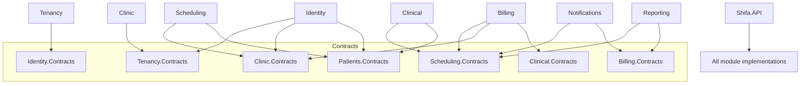

# Module boundaries

> **Layout update (ADR-009):** projects are now `Core/`, `Infrastructure/` and `Shifa/` at the repository root, like Trio HRM. Module rules below still apply, but are checked in review instead of by separate projects.

## Modules

| Module | Schema | Owns | Exposes (Contracts) |
|---|---|---|---|
| Identity | `identity` | Users, Memberships, MembershipBranches, Roles, RolePermissions, RefreshTokens, OtpChallenges | `IIdentityApi` (user/membership lookups), `UserRegistered` |
| Tenancy | `tenancy` | Tenants, Plans, PlanEntitlements, TenantSubscriptions, SubscriptionPayments | `ITenancyApi` (tenant status, entitlement checks), `TenantOnboarded`, `TenantSuspended` |
| Clinic | `clinic` | Branches, Specialties, Doctors, DoctorSpecialties, DoctorBranches, DoctorSchedules, DoctorTimeOffs, Services, ServicePrices | `IClinicApi` (schedules, service duration and price, counts for limits) |
| Patients | `patients` | Patients, PatientIdentifiers, PatientGuardians, PatientAccountAccesses (phone links), PatientConsents | `IPatientsApi` (exists, portal access by phone) |
| Scheduling | `scheduling` | Appointments, AppointmentSlots, AppointmentStatusHistory, IdempotencyRecords | `AppointmentBooked`, `AppointmentCancelled`, `PatientCheckedIn`, `AppointmentNoShow` |
| Clinical | `clinical` | Visits, ClinicalNotes, VitalSigns, Diagnoses, Prescriptions, PrescriptionItems, PatientAllergies, PatientConditions, VisitAttachments, ClinicalAddendums | `VisitCompleted` |
| Billing | `billing` | Invoices, InvoiceItems, Payments, Refunds, CreditNotes, CashierShifts | `InvoiceIssued`, `PaymentRecorded` |
| Notifications | `notifications` | NotificationTemplates, Notifications, DeliveryAttempts, NotificationPreferences | `INotificationsApi` (send in-app) |
| Reporting | `reporting` | DailyBranchStats (projections) | read-only queries |

Every schema also has `OutboxMessages` and `InboxMessages` (ADR-005).

## Dependencies

`Tenancy → Identity.Contracts` exists because onboarding provisions the tenant's default roles and first admin (`IIdentityApi.ProvisionTenantAsync`); `Identity → Tenancy.Contracts` exists for tenant status and plan limits. Both are Contracts-only, so there is no project cycle. `Identity → Clinic.Contracts` validates branch ids stored on memberships. `Identity → Patients.Contracts` lets the patient-portal OTP flow check, inside the clinic's scope, that a phone number is linked to a patient before an SMS is sent.

Arrows are allowed references to **Contracts** only. Reverse arrows are not allowed; if a module needs to react to a downstream change, it subscribes to an event.

## Rules (enforced by `Shifa.ArchitectureTests`)

- `Shifa.Core` references no Shifa project.
- `Shifa.Infrastructure` references only `Shifa.Core`.
- `Shifa.<Module>.Contracts` references only `Shifa.Core`.
- `Shifa.<Module>` references `Shifa.Core`, `Shifa.Infrastructure`, its own Contracts and other modules' Contracts — never another module's implementation.
- Only `Shifa.API` and test projects reference module implementations.
- Every entity is either tenant-owned or explicitly platform-owned.
- Foreign keys between tenant-owned entities include `TenantId`.
- No foreign keys across schemas; other modules' rows are referenced by ID and validated through their Contracts.
