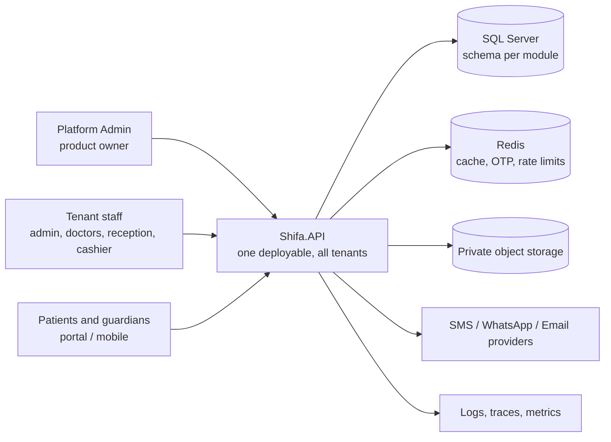

# System architecture

> **Layout update (ADR-009):** projects are now `Core/`, `Infrastructure/` and `Shifa/` at the repository root, like Trio HRM. Module rules below still apply, but are checked in review instead of by separate projects.

Shifa is a multi-tenant clinic management SaaS: one platform, many customer organizations (tenants), each with its own branches, staff, patients and records. Business context: [../vision.md](../vision.md). Decisions: [../decisions/](../decisions/).

## Context



## Building blocks

| Part | Technology | Notes |
|---|---|---|
| API host | ASP.NET Core .NET 10, controllers | `Shifa.API`: pipeline, middleware, module registration only |
| Modules | Class libraries | Identity, Tenancy, Clinic, Patients, Scheduling, Clinical, Billing, Notifications, Reporting ([module-boundaries.md](module-boundaries.md)) |
| Data | SQL Server + EF Core 10 | One `DbContext` and schema per module ([database-design.md](database-design.md)) |
| Tenancy | `ITenantContext`, query filters, composite keys | [tenancy-design.md](tenancy-design.md) |
| Security | Identity + JWT, RBAC + tenant/branch/patient scope | [security-design.md](security-design.md) |
| Events | Transactional outbox + in-process dispatcher | ADR-005 |
| Jobs | Hangfire (SQL Server storage) | Reminders, no-show marking, cleanup, reports |
| Cache | Redis via HybridCache | Tenant-prefixed keys; never the booking authority |
| Logging | Serilog → console, Seq locally | No medical data, tokens or OTPs in logs |
| Observability | Serilog logs + health checks (`/health/live`, `/health/ready`) | No OpenTelemetry (product owner, ADR-017) |

## Request pipeline

```
Request
 → GlobalExceptionHandler (UseExceptionHandler)     every error becomes a Response
 → Serilog request logging
 → Localization (en, ar)
 → Authentication (JWT)
 → TenantResolutionHandler                          validated membership → ITenantContext (set once)
 → Authorization ([Authorize], [Permission], branch / patient checks in repos)
 → Controller → I<Name>Repo → <Name>Repo → Response
```

## Solution layout

```
src/
├─ Shifa.API/                 Program.cs, Middleware/, Extensions/
├─ Shifa.Core/                Common/ (Response, BusinessException), Entities/ (BaseModel, TenantOwnedEntity),
│                             Enums/, Interfaces/ (ICurrentUser, ITenantContext), LanguageResource
├─ Shifa.Infrastructure/      Common/ (CurrentUserManager, TenantManager, Validation), Data/ (ModuleDbContext,
│                             interceptors), Caching/, Services/
└─ Modules/<Module>/
   ├─ Shifa.<Module>/            HRM folder conventions (ADR-004)
   └─ Shifa.<Module>.Contracts/  I<Module>Api, Events/
tests/
├─ Shifa.ArchitectureTests/   boundaries and entity ownership
└─ Shifa.IntegrationTests/    real SQL Server: tenant isolation, API
```

## Deployment shape

One container image of `Shifa.API` (stateless, horizontally scalable) + SQL Server + Redis + private object storage. Hangfire server runs in the same process at first and can move to a separate worker process of the same image if job load grows. Production details (backups, RPO/RTO, secrets) are designed in Phase 10.
