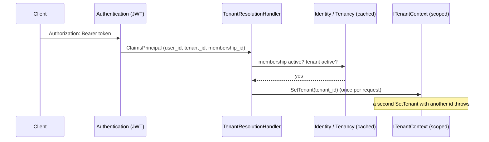

# Tenancy design

Decision: ADR-002. Authentication model: ADR-007.

## Concepts

| Term | Meaning |
|---|---|
| Platform | The Shifa product. Owns Tenants, Plans, Subscriptions. |
| Platform Admin | Product owner staff. Separate authorization boundary; cross-tenant access is audited. |
| Tenant | A customer organization (e.g. Al Noor Clinics). |
| Membership | A user's access to one tenant: roles + branch scope. A user can have memberships in several tenants. |
| Branch | A physical clinic of a tenant. Has its own time zone, schedules and prices. |
| Patient profile | Medical identity inside one tenant. The same person in two tenants has two independent profiles. |

## Ownership

| Kind | Base type / marker | Examples | Filter |
|---|---|---|---|
| Tenant-owned | `TenantOwnedEntity` (`TenantId`) | Branch, Doctor, Patient, Appointment, Invoice | `Tenant` + `SoftDelete` |
| Platform-owned | `BaseModel` + `[PlatformOwned]` | Tenant, Plan, PlanEntitlement, User | `SoftDelete` only |

An architecture test fails when an entity is neither.

## How the tenant is resolved

- The tenant ID comes **only** from a validated token claim. Request bodies and query strings never carry it; models don't have a `TenantId` property.
- No tenant claim → `ITenantContext.TenantId` is null → tenant-owned queries return nothing and tenant-owned writes throw.
- Phase 1 implements the context, the handler (claim → context) and the data-layer enforcement. Membership/tenant status validation is added in Phase 2 with Identity.

## Enforcement layers

1. **Query filter `Tenant`** (EF Core 10 named filter) on every tenant-owned entity: `CurrentTenantId != null && e.TenantId == CurrentTenantId`.
2. **Save interceptor** (`AuditTenantInterceptor`):
   - Added: stamps `TenantId` from the context; throws if the entity already has a different `TenantId` or there is no tenant context.
   - Modified / Deleted: throws if the row belongs to another tenant or `TenantId` was changed.
3. **Composite keys:** unique `(TenantId, Id)` on every tenant-owned table; child FKs are `(TenantId, ParentId) → (TenantId, Id)`. The database rejects a child that points to another tenant's parent.
4. **Authorization:** permission policies, branch scope and patient access checks in repos.
5. **Tests:** cross-tenant read/update/delete attempts in `Shifa.IntegrationTests`.

## Platform Admin access

Platform endpoints live under `api/platform/...` with the `PlatformAdmin` policy. Cross-tenant reads use `IgnoreQueryFilters(["Tenant"])` explicitly in platform repos and write an audit record (who, what, which tenant, why). Platform code never sets a tenant context to impersonate a tenant user.

## Rules for risky areas

| Area | Rule |
|---|---|
| Raw SQL | Avoid. If needed: parameterized, includes `TenantId = @tenantId` from the context, reviewed. |
| Bulk updates (`ExecuteUpdate/Delete`) | Query filters apply, but the interceptor does not; always start from a filtered query and never use `IgnoreQueryFilters` here. |
| Background jobs | Job arguments include `TenantId`. The job creates a scope, validates the tenant is active, then sets the context. Jobs are idempotent. |
| Outbox / events | Each message stores `TenantId`; the consumer sets the context from it before handling. |
| Cache | Keys always start with `t:{tenantId}:`; built by a helper that takes the tenant ID from the context. |
| Files | Paths `tenants/{tenantId}/...` in a private container. Downloads go through an endpoint that checks ownership and returns a short-lived signed URL. |
| Reports / exports | Run through filtered `DbContext`s plus branch scope. Totals never mix tenants. |
| Cross-module queries | Through `I<Module>Api`, which runs inside the caller's tenant context. |
| Unique constraints | Business-unique values are unique per tenant: `(TenantId, Code)`, `(TenantId, Mrn)`. |
