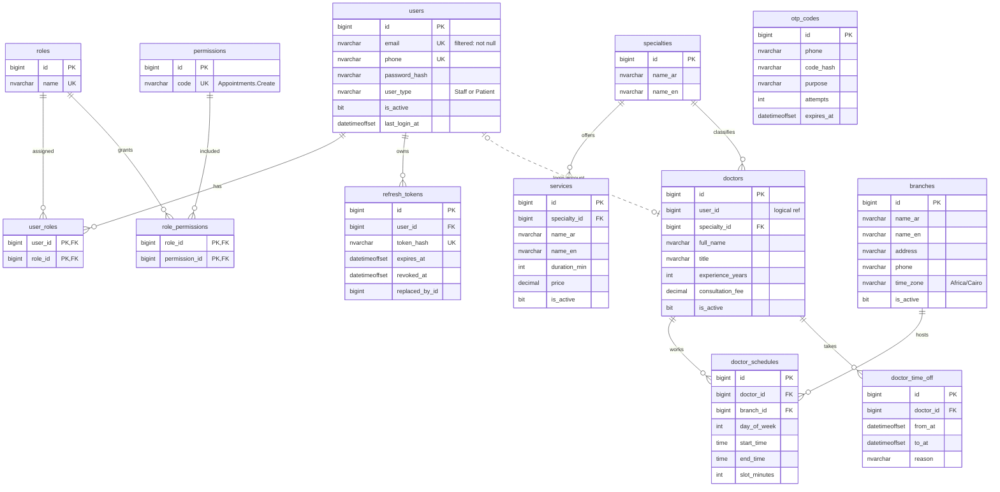
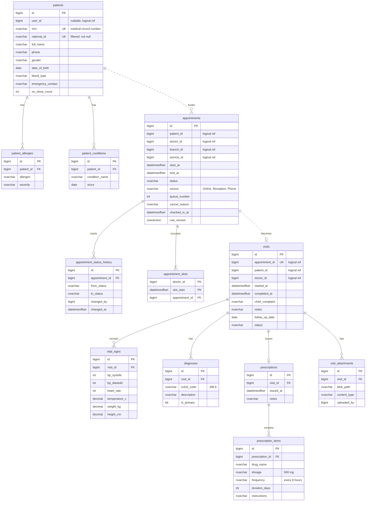
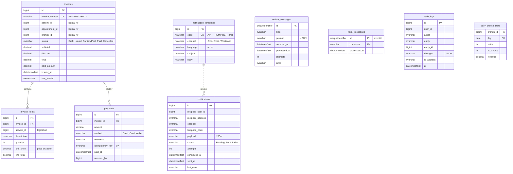

# ERD — Shifa

## Conventions

- **One SQL Server schema per module**: `identity`, `clinic`, `patients`, `scheduling`, `clinical`, `billing`, `notifications`.
- **Solid line** = real foreign key inside one schema. **Dashed line** = logical reference across modules: we store the ID only, with no FK. This is what lets a schema move to its own database later.
- IDs are `bigint`, generated by EF Core HiLo sequences in each schema (ADR 0006). Event IDs in `outbox_messages` and `inbox_messages` are `uniqueidentifier`.
- Times are `datetimeoffset` stored in UTC. Each branch stores its time zone.
- Every important table also has `created_at`, `created_by`, `updated_at`, `updated_by`, `is_deleted`. They are omitted from the diagrams.
- Tables edited concurrently (`appointments`, `invoices`) have a `rowversion` column for optimistic concurrency.

## Identity + Clinic Setup

## Patients + Scheduling + Clinical

## Billing + Notifications + shared tables

`outbox_messages` and `inbox_messages` exist in **every** module schema. `daily_branch_stats` is filled by a nightly background job.

## Constraints and indexes

| Table | Constraint / index | Why |
|---|---|---|
| `scheduling.appointment_slots` | Primary key `(doctor_id, slot_start)` | Each appointment occupies its time slots (a 30-min visit on a 15-min grid = 2 rows). If two requests try to take the same slot at the same moment, only one succeeds. This replaces PostgreSQL exclusion constraints, which SQL Server doesn't have. Cancelling an appointment deletes its slot rows. |
| `scheduling.appointments` | Index `(branch_id, start_at)` and `(patient_id, start_at)` | Reception's daily screen; the patient's appointments in the app |
| `clinical.visits` | Unique `appointment_id` | One visit per appointment |
| `patients.patients` | Unique `mrn`; filtered unique `national_id WHERE national_id IS NOT NULL`; index `phone` | No duplicate patients. The filter matters: SQL Server treats NULL as a value in a unique index, so without it only one patient (e.g. a child) could have no national ID |
| `identity.users` | Filtered unique `email WHERE email IS NOT NULL`; unique `phone` | Patients log in by phone and may have no email |
| `billing.invoices` | Unique `invoice_number` | Human-readable, sequential per year |
| `billing.payments` | Unique `idempotency_key` | A payment is never recorded twice if the request is retried |
| `*.outbox_messages` | Filtered index `WHERE processed_at IS NULL` | The processor reads only unsent messages |
