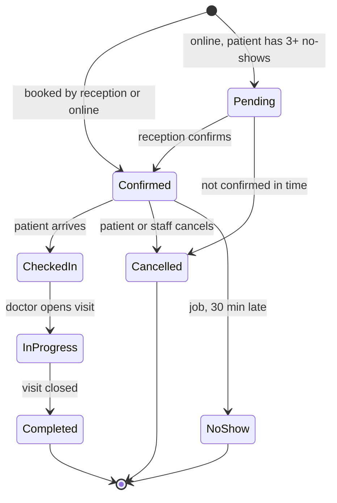

# Vision — Shifa

## The product

**Shifa** is a multi-tenant clinic management SaaS. The platform owner sells subscriptions to clinics, medical centers and healthcare organizations. Each customer is a **tenant** that manages its own branches, doctors, services and prices, staff and permissions, patients, appointments, medical records, invoices and reports, with its data strictly isolated from every other tenant (ADR-002).

New customers are onboarded by the Platform Admin without new deployments or code changes. Plans define limits (branches, doctors, employees, modules) and trial periods.

## Reference tenant

We size the system against a typical (fictional) tenant, **Al Noor Clinics**, a multi-specialty outpatient group. The platform must serve many tenants of this size and smaller.

| Metric | Value |
|---|---|
| Branches | 3 (Cairo and Giza) |
| Doctors | 25 |
| Specialties | 8 |
| Visits per day | ~400 |
| Monthly active patients on the app | ~5,000 |
| Time zone | Africa/Cairo |

**What the numbers mean for scale:** 400 visits/day is about 150k appointments/year, which is small for SQL Server. The real load is patients **browsing available slots** in the app before they book. That read path is where caching matters.

## Problems and how the system solves them

| Problem | Solution | Module |
|---|---|---|
| 25–30% of appointments are no-shows; doctors sit idle | SMS reminders 24h and 2h before the appointment; track repeat no-show patients | Notifications, Scheduling |
| Booking is by phone; reception is overloaded | Online booking against real availability; a daily queue per doctor | Scheduling |
| Paper files; the doctor can't see the patient's history | EMR: visits, vitals, ICD-10 diagnoses, prescriptions, allergies, chronic conditions | Clinical, Patients |
| Money leaks between the visit and the cash desk | An invoice is created automatically at check-in; partial payments; daily close per branch | Billing |
| The owner doesn't know the numbers | Daily report: revenue, visits, no-show rate, doctor utilization | Reporting |

## Users

| User | Main jobs |
|---|---|
| Patient | Find a doctor by specialty and branch; book, cancel, reschedule; see prescriptions and invoices |
| Receptionist | Book for walk-in and phone patients; check-in and queue number; collect payments |
| Doctor | See schedule and queue; open the visit, write diagnosis and prescription; set follow-up |
| Admin / Owner | Branches, services and prices; doctors, schedules and permissions; reports |

## MVP scope (v1)

| Module | In MVP | Later (v2+) |
|---|---|---|
| Identity | Staff login, patient OTP login, JWT + refresh rotation, roles and permissions | 2FA, social login, separate identity service |
| Clinic Setup | Branches, specialties, services and prices, doctors, schedules, time off | Rooms and equipment, per-branch pricing |
| Patients | Patient profile, MRN, allergies, chronic conditions | Family accounts, document upload |
| Scheduling | Available slots, book/cancel/reschedule, check-in, queue, no-show | Waitlist, recurring bookings, telemedicine |
| Clinical (EMR) | Visit, vitals, diagnosis, prescription, attachments | Lab and radiology orders and results, specialty templates |
| Billing | Invoice per visit, cash/card, partial payment, daily close | Online payment, insurance claims, packages and discounts |
| Notifications | Booking confirmation, reminders, receipts (SMS/email) | WhatsApp Business, push notifications |
| Reporting | Daily report and a basic dashboard | Custom reports, large exports |

## Key business rules

1. A booking must fall inside the doctor's schedule at that branch, and not during time off.
2. A doctor can never have two overlapping appointments. The database enforces this (see `AppointmentSlots` in [architecture/database-design.md](architecture/database-design.md)).
3. A patient cannot have more than one appointment with the same doctor on the same day.
4. Patients can cancel from the app up to 3 hours before the appointment (configurable).
5. A patient with 3 or more no-shows gets online bookings in `Pending` until reception confirms them.
6. A confirmed appointment not checked in 30 minutes after its start becomes `NoShow` and increments the patient's `no_show_count`.
7. A visit can be opened only for a `CheckedIn` appointment. Only the visit's doctor can edit it. After `Completed` it is locked; only addenda can be added.
8. The invoice is created at check-in using the service price at that moment (price snapshot). Later price changes don't affect it.

## Appointment lifecycle

## Success metrics

| Metric | Today (assumed) | Target after 3 months |
|---|---|---|
| No-show rate | 25–30% | under 12% |
| Share of bookings made online | 0% | 40% |
| Visits without an invoice | unknown | 0 |
| Time for the owner to get daily numbers | next day, by phone | 11 PM, automatic email |
